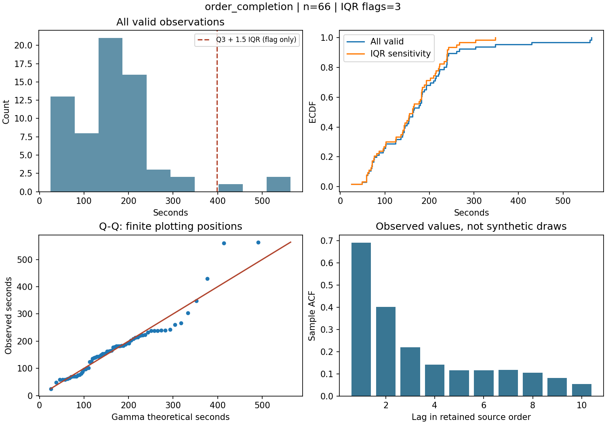
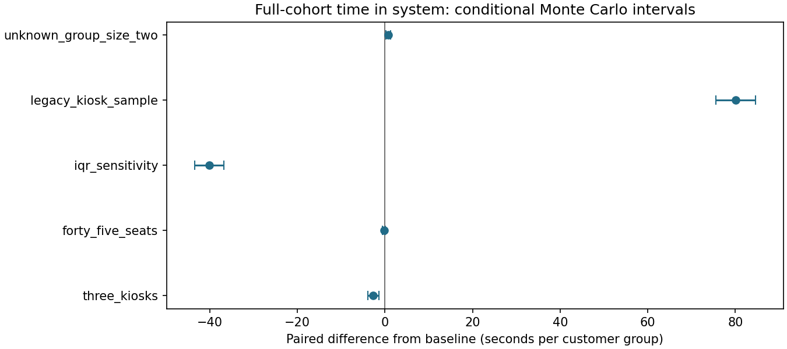

# 已运行的参考实验

这是 2026-10-17 在隔离 Python 3.13.5 环境完成的实际运行快照。包括 17 项通过的测试、输入分析、6 个情景各 100 次仿真，以及每个情景第 1 次重复的逐组和事件日志。原始课程贡献与本次新增实现的说明见 [项目 README](../../README.md)。

## 如何复现

按项目 README 安装依赖后，从仓库目录运行：

```bash
python -B run.py --output results/my-reproduction
```

输出目录需为新目录或空目录。打开生成的 `report.html`。本目录中的 [报告快照](report.html) 可在克隆或下载仓库后用浏览器打开；GitHub 页面直接展示的结果见下文。运行配置、输入哈希和代码哈希均在 [run.json](run.json)。

## 数据诊断

- 66 条订单到完成时间的均值为 **174.030 秒**，最大值为 **564 秒**；IQR 标记 3 条，基线全部保留。
- 周六表中的 8 条点单机操作记录均值为 **88.666 秒**；旧 Notebook 的 45 条记录均值为 **217.067 秒**。来源不能确认相同，分别作为基线与敏感性输入。
- 原订单完成序列存在明显相关性；Q–Q 尾部问题也包含旧代码把概率取为 1 的数值错误。不能据此认定所有长尾都是应删除的异常值。



## 参考仿真结果

基线使用 2 台点单机、35 个座位，重放固定的 56 组观察到达。完整入场顾客组的平均系统逗留为 **20.803 分钟**，包含就餐；使用机器顾客组的平均机前等待为 **5.034 秒**，堂食顾客组的平均座位等待为 **0.275 秒**。观察窗口末平均还有 **4.00 组**未离开，随后继续排空。

下表为同种子配对的“情景减基线”，指标是完整入场顾客组平均系统逗留时间。

| 单项变化 | 平均差 / 秒 | 95% Monte Carlo 区间 / 秒 |
| --- | ---: | --- |
| 点单机从 2 台增加到 3 台 | −2.697 | [−3.958, −1.437] |
| 座位从 35 个增加到 45 个 | −0.251 | [−0.550, 0.048] |
| 输入采用 IQR 筛选 | −40.143 | [−43.473, −36.812] |
| 改用旧 Notebook 点单时长 | +80.076 | [75.595, 84.556] |
| 缺失同行人数从 1 人改为 2 人 | +0.726 | [0.214, 1.238] |



这些结果表明：在当前假设和记录下，输入来源及筛选规则会明显影响结果；不能把 IQR 行的下降解释成门店运营改善。区间只反映固定输入和模型假设下的仿真随机性，未包含输入抽样、序列相关和模型结构误差。资源变化也未获得真实门店的外部验证。

## 可检查的证据

- [600 行逐次仿真结果](simulation/replications.csv)、[摘要](simulation/summary.json)、[配对差异](simulation/paired_differences.json)。
- [基线第 1 次逐组记录](simulation/baseline_parties.csv)、[事件与资源日志](simulation/baseline_events.csv)；其他五个情景的相同日志也保存在 `simulation/`。
- [逐条 IQR 标记](input/iqr_flags.csv)、[全部输入统计](input/summary.json)、[全部拟合与诊断](input/fits.json)。
- [测试输出](tests.txt)、[实际依赖](environment.txt)、[与前次运行比较](comparison.json)、[验证范围](../validation.md)。

本目录是可重新生成的提交快照；日常运行输出写入被 Git 忽略的顶层 `results/`。本次日志仅隐去本机绝对路径，没有删除警告或修改实验结果。
